  

  
  

  

## About Me

I build data-focused applications that turn operational and customer data into clear, repeatable outputs. My work combines **Python data processing**, **reporting automation**, **APIs**, and **applied machine learning**.

I care about clean inputs, traceable transformations, and tools that people can use in their day-to-day work.

## Tools & Technologies

**Data & machine learning** 
    

**Applications & automation** 
   

  
  

  
  

Thanks for visiting my profile.

<!-- Visual structure and SVG assets adapted from Profile Signal Kit, MIT License. See THIRD-PARTY-NOTICES.md. -->
